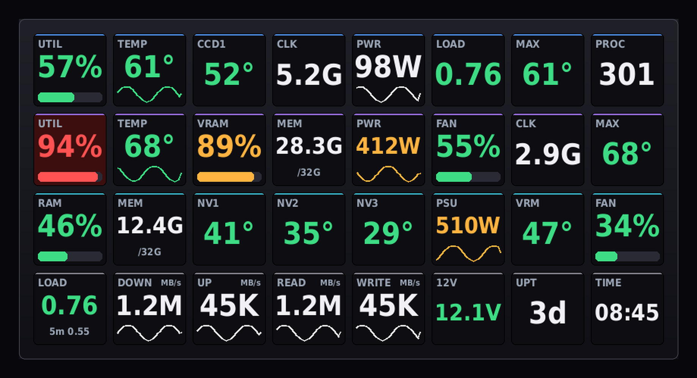

# Deck Stats — Stream Deck 8×4 dashboard



> Device mockup rendered by `deck_stats.py --preview`; shown values are simulated.

On-screen system monitoring for **Stream Deck XL** (32 addressable keys =
4 rows × 8 columns). No Elgato plugins required — plain Python, `psutil`,
hwmon and `nvidia-smi`.

## Layout

```
        0     1     2     3     4     5     6     7
CPU     UTIL  TEMP  MAX   CLK   PWR   LOAD  CCD1  CORE
GPU     UTIL  TEMP  MAX   CLK   PWR   FAN   VRAM  MEM
SYSTEM  TIME  NV1   NV2   NV3   DSK   SWAP  RAM   MEM
I/O+PSU DOWN  UP    READ  WRITE PSU   FAN   VRM   12V
```

Columns 0–4 of the CPU and GPU rows carry the same metric in the same column,
so the two rows read as one table and a value can be compared vertically. `PSU`
sits under the two `PWR` keys (all watts) and the PSU `FAN` under the GPU `FAN`.
Row 3 is I/O on the left and power supply on the right.

## Graphic rules

- 4–6 char label on top, small; large centered value
- Value typeset in DejaVu Sans **Condensed** Bold when the distro ships it
  (plain Bold otherwise), so 5-character values such as `28.3G` or `412W`
  still render at 30 px or more
- Unit inside the value, not in the label: `45°` `66W` `3.7G` `2.8G`
- A separate unit sits in the top-right corner only where the value carries none
  of its own — the rates: `DOWN` `UP` `READ` `WRITE` show `MB/s`. If the label
  plus the unit would not fit, the unit is dropped for that key only
- `LOAD` shows the 1 min average large, with the 5 min one as a small second line
- `TIME` shows the clock large, with the uptime underneath: `up 3d 04h`,
  `up 4h 07m`, `up 12m`. Uptime comes from `psutil.boot_time()`, so it also
  covers suspend time (a `time.monotonic()` uptime would not)
- `MEM` (GPU), `MEM` (RAM) and `DSK` show the total as a small second line:
  `28.3G` over `/32G`, `842.1G` over `/1863G`. A missing total means no line,
  never a fake one
- `DSK` is the free space on `/` — what a normal user can still write, not
  counting the reserve the root filesystem keeps for itself
- Colored bar **only** on UTIL, CORE, VRAM, RAM, SWAP and FAN %
- **Sparkline** (last 40 samples, ~1 min at 1.5 s) in the bottom zone of the
  keys that would otherwise leave it empty: CPU/GPU `TEMP`, CPU/GPU `PWR`,
  `PSU`, `DOWN`, `UP`, `READ`, `WRITE`. The bottom zone holds exactly one thing,
  in priority order: bar → sub-line → sparkline. The line is scaled min-max over
  the window, with a minimum span of 1 % of the value so a flat series stays flat
  instead of blowing up sensor noise, and it is drawn in the key's current color
- A 3 px accent strip on the top edge of every key marks its group:
  blue = CPU row, violet = GPU row, cyan = SYSTEM row, gray = `TIME` (a clock,
  not a system metric) and the I/O keys, pink = the power-supply half of row 3.
  These hues are outside the green/amber/red family on purpose, which is
  reserved for status
- `UTIL` is the average load across all threads; `CORE` is the busiest single
  logical CPU. On a wide CPU the two tell different stories: 3 % average can
  still mean one thread pinned at 100 %. `CORE` is amber from 90 %, and
  deliberately **never red**: one saturated thread is normal, not an alarm
- Temperatures: green normal → yellow → red
- `LOAD` has no absolute warning level: it is normalised by core count, yellow
  from 70 % of the cores, red from 100 %. The 5 min average stays a gray sub-line
- `12V` is colored by the deviation from 12.00 V: yellow from 5 %, red from 8 %
- `SWAP` is yellow from 50 % and red from 80 % — in use at all is the signal,
  saturating it is the alarm
- A key that reaches its critical threshold also gets a dark red background
  tint, so the alarm survives the distance
- `--` = sensor unavailable at that moment (never a placeholder `0`)

## Data sources

| Group | Sources |
|---|---|
| CPU | `psutil.cpu_percent` (UTIL average, CORE busiest thread), `/proc/loadavg` (LOAD, 1 and 5 min), `k10temp` or `coretemp` hwmon (TEMP, CCD1), RAPL (PWR), cpufreq (max core CLK) |
| GPU | `nvidia-smi` (util, temp, VRAM, power, fan, clock) |
| SYSTEM | RAM/swap (`psutil.virtual_memory`, `psutil.swap_memory`), NVMe hwmon temperatures (NV1–NV3), `os.statvfs("/")` (DSK: free space) |
| I/O | `/proc/net/dev` (DOWN, UP), `/proc/diskstats` (READ, WRITE) |
| PSU | `corsairpsu` hwmon *(optional: power, VRM, fan, 12 V rail)* |
| Clock | local time, `psutil.boot_time()` (uptime, suspend-aware) |

Everything is auto-detected: the CPU temperature chip, the RAPL package
domain, the NVMe drives and the PSU are looked up at startup and reported on
the first log line (`Sensors: {...}`). Missing sensors simply render `--`.

## Configuration

All thresholds have defaults that suit a high-end desktop; override them per
machine through environment variables (put them in the unit's
`Environment=` lines or in your shell for manual runs):

| Variable | Default | Meaning |
|---|---|---|
| `DECK_UPDATE_SECONDS` | `1.5` | refresh interval |
| `DECK_BRIGHTNESS` | `70` | deck brightness 0–100 |
| `DECK_PEAK_WINDOW` | `3600` | horizon of the `MAX` keys, in seconds |
| `DECK_GPU_POWER_MAX` | `550` | GPU board power limit (W); warn at 65 %, red at 90 % |
| `DECK_PSU_POWER_MAX` | `650` | PSU rated output (W); warn at 70 %, red at 92 % |

## Installation

```bash
# 1. Dependencies (any location — no paths are hardcoded)
python3 -m venv .venv
.venv/bin/pip install -r requirements.txt

# 2. Permissions (deck access + readable RAPL counter) — needs sudo password
./install-udev.sh

# 3. Run manually
.venv/bin/python deck_stats.py

# 4. Or install the systemd user service (paths resolved at install time)
./install-service.sh
journalctl --user -u deck-stats -f
```

`install-service.sh` generates `~/.config/systemd/user/deck-stats.service`
from the `deck-stats.service` template, substituting the absolute path of your
checkout. Remove it with `./install-service.sh --remove`.

## Utilities

```bash
.venv/bin/python deck_stats.py --preview   # whole deck preview (8×4) in /tmp/deck_preview
journalctl --user -u deck-stats -f         # live logs
```

## Notes

- Fixed-rate loop: the interval is measured with `time.monotonic()`, so slow
  ticks do not accumulate drift. `nvidia-smi` costs ~50 ms per tick.
- `CLK` is the highest current core clock across all cores (`scaling_cur_freq`),
  not `cpu0`: the sampler's own core is a poor proxy for boost.
- `MAX` is a rolling peak over `DECK_PEAK_WINDOW`, not an all-time maximum, so
  an old spike does not pin the key forever.
- Rates (DOWN/UP/READ/WRITE) start from the second tick (the first one samples
  the baseline).
- Disk I/O counts whole block devices only: partitions are reported by
  `/proc/diskstats` with overlapping counters and would double the rate.
- `NV1`–`NV3` follow controller order (`nvme0`, `nvme1`, `nvme2`), not `hwmonN`
  numbering: the latter is assigned at probe time and can change between boots,
  which would silently swap the drive behind a label. Extra drives are reported
  on the startup log line (`Sensors: {...}`); SATA disks expose no temperature
  unless the `drivetemp` module is loaded (they are not read yet).
- In the GPU row, an `nvidia-smi` field the driver cannot read (`[N/A]`,
  `[Not Supported]`) is a missing value, not a read failure: that key shows
  `--`, the rest of the row stays live and nothing is logged every tick. Only
  a read that genuinely failed (timeout, missing binary, short CSV row) blanks
  the whole GPU block.
- If the deck is unplugged the script reconnects automatically; on exit
  (Ctrl-C or SIGTERM from systemd) it blanks the keys instead of leaving stale
  numbers lit.
- If RAPL still gives "Permission denied" (`-r--------`), re-run
  `./install-udev.sh`.

## Reference setup and known adaptations

Measurements were tuned on one machine (MSI X870E + Ryzen 9 + RTX 5090,
Corsair PSU); other hardware works, some keys fall back:

| Key | Intended | Fallback when unavailable |
|---|---|---|
| CPU PWR | RAPL package power | **PSU total − GPU** (rest of the system) if the counter is unreadable |
| CPU FAN | motherboard fan | no fan sensor on the MSI board → uses the PSU fan (pwm %) |
| CPU 12V | vcore | vcore not exposed → **PSU 12V rail** |
| GPU MAX | hotspot | hotspot not exposed by `nvidia-smi` → rolling peak of GPU temp |

## Related projects

Similar open-source work is rare and mostly split in two camps: **standalone**
apps that talk to the device themselves (like this one), and **plugins** that
need a host — the Elgato Stream Deck app, or [OpenDeck](https://github.com/nekename/OpenDeck)
on Linux. Standalone, closest in approach:

| Project | Lang | Platform | Notes |
|---|---|---|---|
| [ZoutMax/FifineControlDeck](https://github.com/ZoutMax/FifineControlDeck) | Python / PyQt6 | Linux | for the fifine "Stream Dock" clone (USB `3142:0060`), not an Elgato; keys for CPU, RAM, VRAM, GPU load/temps, network, disk space |
| [LabRaTox/Deck-Switch](https://github.com/LabRaTox/Deck-Switch) | Python / PyQt6 | Linux | real Stream Deck hardware, own plugin system with a built-in *system* plugin |
| [SmokeyMcBong/StreamDeckMonitor](https://github.com/SmokeyMcBong/StreamDeckMonitor) | C# / .NET | Windows | background console app, CPU/GPU/FPS via MSI Afterburner + StreamDeckSharp |

Plugins (they need the vendor app or OpenDeck running):

| Project | Lang | Platform | Notes |
|---|---|---|---|
| [kahikara/opendeck-redline-monitor](https://github.com/kahikara/opendeck-redline-monitor) | JavaScript | Linux (OpenDeck) | richest metric set, keys **and** encoders, sysfs-first |
| [moeilijk/lhm-streamdeck](https://github.com/moeilijk/lhm-streamdeck) + [lhm-companion](https://github.com/moeilijk/lhm-companion) | JavaScript / Go | Linux, Windows | sensor data served in LibreHardwareMonitor's `data.json` format |
| [Yoshiofthewire/agentglass-streamdeck](https://github.com/Yoshiofthewire/agentglass-streamdeck) | TypeScript | Linux (OpenDeck) | sysfs every tick, `nvidia-smi` every 15 s |
| [ShoMetrics/sho_metrics](https://github.com/ShoMetrics/sho_metrics) | TypeScript | Windows, macOS | Marketplace plugin, includes custom HTTP JSON endpoints |

Related but not a Stream Deck: [LabRaTox/EdgeDisplayWidgets](https://github.com/LabRaTox/EdgeDisplayWidgets)
("Edge Dashboard") drives a Corsair Xeneon Edge 14.5" second display from
`/sys/class/hwmon` and NVML through a FastAPI + QML kiosk.

Commercial equivalents on the Elgato Marketplace: *Metrics*, *System Vitals*,
*HWiNFO*.

How this project differs from the options above:

- **No host app at all.** Direct hidapi via `python-elgato-streamdeck`, one
  process, no Elgato/OpenDeck install and no cloud account.
- **Deep hardware access on Linux.** CPU package power from RAPL, PSU
  telemetry from the `corsairpsu` hwmon (VRM temperature, 12 V rail, fan),
  NVMe hwmon temperatures — none of the projects above expose these.
- **Whole 32-key frame** refreshed at a fixed rate from `time.monotonic()`.

## License

MIT — see [LICENSE](LICENSE).
